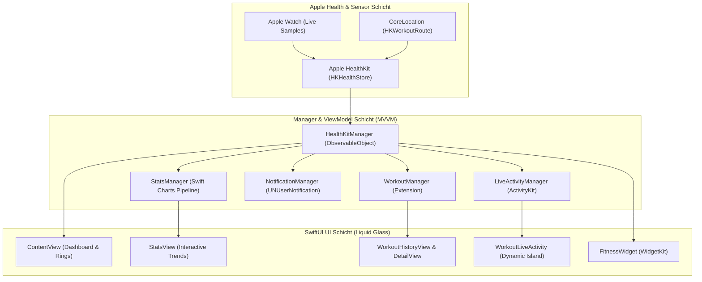

# 🏃‍♂️ FitnessApp – Next-Gen BioMetrics & HealthKit Engine (iOS)

[](https://swift.org)
[](https://developer.apple.com/ios/)
[](https://developer.apple.com/xcode/swiftui/)
[](https://developer.apple.com/documentation/healthkit)
[](https://developer.apple.com/documentation/activitykit)
[](https://github.com/mariusschaffrath/FitnessApp/actions/workflows/ios-test.yml)
[](LICENSE)

Eine hochmoderne, native iOS Fitness- & Biometrie-Zentrale im **Liquid Glassmorphism Design**. Entwickelt mit striktem **Privacy-First-Paradigma**, direkter HealthKit-Anbindung als einziger *Source of Truth*, interaktiven Swift Charts und nahtloser Integration in die **Dynamic Island** sowie **Live Activities**.

---

## 🌟 Hauptfunktionen (Features)

- ⭕ **Multidimensionale Aktivitätsringe:** Originalgetreue Vektordarstellung der Apple Activity-Ringe (*Bewegen, Trainieren, Stehen*) plus erweiterte Ringe für *Schritte* und *Hydrierung*.
- 📈 **Swift Charts & Trend-Analysen:** Interaktive Balken- und Flächendiagramme mit Zero-Fill-Algorithmus zur lückenlosen Darstellung von Tagen, Wochen, Monaten und Jahren mit haptischem Tap-to-Reveal.
- 🏋️ **Workout Hub mit 40+ Sportarten:** Automatische Synchronisation aller Apple Watch Trainings inklusive Herzfrequenzzonen, Kalorienverbrauch, Streckenmessung und Indoor/Outdoor-Klassifizierung.
- 🏝️ **Dynamic Island & Live Activities:** Echtheits-Tracking laufender Trainings mit animierter Herzfrequenz, Kalorienzähler und Stoppuhr direkt auf dem Sperrbildschirm und in der Dynamic Island.
- 🗺️ **MapKit Routen-Visualisierung:** Auslesen und interaktives Rendern von GPS-Workout-Routen aus `HKWorkoutRoute`.
- 🔒 **Absolute Privatsphäre:** Keine Cloud-Server, keine Werbetracker, keine Analyse-SDKs. Sämtliche biometrischen Daten verbleiben zu 100 % in der gesicherten Apple Health Sandbox auf dem Gerät.

---

## 🏗️ Systemarchitektur



---

## 🎨 Apple Human Interface Guidelines (HIG) Compliance

Das Design folgt strikt den modernsten Apple Human Interface Guidelines:
- **Spatial Glassmorphism:** Verwendung von `.ultraThinMaterial` und abgestuften Kantenlichtern für natürliche Tiefenwirkung im Dark Mode.
- **Dynamic Color Harmony:** Mathematisch abgestimmte Verläufe basierend auf den kanonischen Apple Ring-Farben (*Ultra Orange, Move Red, Exercise Green, Stand Cyan*).
- **Haptic Engine:** Kontextsensitives taktiles Feedback via `UIImpactFeedbackGenerator` und `UINotificationFeedbackGenerator` bei Zielerreichung und Ring-Interaktionen.
- **Dynamic Island Adaptation:** Unterstützung für alle 4 Präsentationsmodi von ActivityKit:
  - *Compact Leading:* Dynamisches Sportarten-Icon.
  - *Compact Trailing:* Live-Herzfrequenzanzeige.
  - *Minimal:* Animierter Aktivitäts-Indikator.
  - *Expanded:* Vollständiges HUD mit Herzfrequenz, Kalorien und Laufzeit.

---

## 🛡️ HealthKit Permission & Privacy Model

Die App fordert ausschließlich granulare Berechtigungen an, die für die Visualisierung zwingend erforderlich sind:

```swift
// Angefragte HealthKit Quantity- & Category-Types
let typesToRead: Set = [
    HKQuantityType.quantityType(forIdentifier: .stepCount)!,
    HKQuantityType.quantityType(forIdentifier: .activeEnergyBurned)!,
    HKQuantityType.quantityType(forIdentifier: .appleExerciseTime)!,
    HKQuantityType.quantityType(forIdentifier: .dietaryWater)!,
    HKQuantityType.quantityType(forIdentifier: .heartRate)!,
    HKCategoryType.categoryType(forIdentifier: .appleStandHour)!,
    HKSeriesType.workoutRoute(),
    HKObjectType.activitySummaryType(),
    HKObjectType.workoutType()
]
```

---

## 🚀 Entwicklung & Cloud CI

### Lokale Entwicklung (Xcode)
1. Repository klonen:
   ```bash
   git clone https://github.com/mariusschaffrath/FitnessApp.git
   ```
2. `FitnessApp.xcodeproj` in Xcode 15+ öffnen.
3. HealthKit Capability ist über `FitnessApp.entitlements` konfiguriert.
4. Auf Simulator (*iPhone 16 / iOS 17+*) oder physischem Testgerät ausführen.

### Automatisiertes CI/CD via GitHub Actions
Jeder Commit auf `main` wird automatisch in der Cloud gebaut und getestet:
```yaml
# Auszug aus .github/workflows/ios-test.yml
- name: Compile iOS App (Simulator Target)
  run: |
    xcodebuild \
      -project FitnessApp.xcodeproj \
      -scheme FitnessApp \
      -destination 'generic/platform=iOS Simulator' \
      -configuration Debug \
      CODE_SIGNING_ALLOWED=NO \
      build
```

---

## 📄 Lizenz
Lizenziert unter der **MIT-Lizenz** – siehe [LICENSE](file:///Users/mariusschaffrath/Desktop/FitnessApp/FitnessApp/LICENSE).
